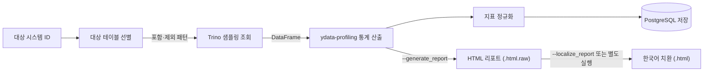

<h1 align="center">Data Quality Metrics</h1>

<p align="center">데이터 품질 관리를 위한 지표 생성 모듈 — Open VDAP Platform</p>

<p align="center">
  <a href="../LICENSE"></a>
  
  
</p>

분산 저장된 데이터의 통계적 특성을 산출하여 **품질 지표**로 제공하는 모듈입니다. 컬럼 단위 분포·결측률·고유값·자료형·상관관계를 집계하고, 결과를 조회 가능한 형태로 저장하며 리포트로도 출력합니다.

Open VDAP Platform이 관리하는 **프로파일링 설정과 스케줄링의 실행부**에 해당합니다. 데이터 카탈로그에서 데이터 품질을 판단하는 근거로 사용됩니다.

본 모듈은 Python으로 작성되어 있으며 **Gradle 빌드 범위에 포함되지 않습니다.** 독립적으로 설치·실행합니다.

## Contents

- [주요 기능](#features)
- [동작 구조](#workflow)
- [구성 요소](#components)
- [설치와 실행](#quick-start)
- [설정](#configuration)
- [사용 예시](#usage)
- [산출 지표](#metrics)
- [검증 범위](#validation)
- [라이선스](#license)

## Features

- **품질 지표 산출:** 컬럼 단위 분포, 결측률, 고유값 수, 자료형 추론, 기술통계와 컬럼 간 상관관계를 집계합니다.
- **대상 선별:** `database`·`table` 단위로 포함·제외를 지정하고, 테이블당 샘플링 행 수를 제한합니다. 평균 길이가 긴 문자열 컬럼은 자동 제외합니다.
- **증분 산출:** 스키마와 행 수가 그대로인 테이블은 건너뜁니다. 증분 모드여도 `refresh_days` 주기마다 한 번은 재처리합니다.
- **병렬 처리:** CPU 비율 기반으로 워커 수를 자동 계산합니다. 컨테이너 CPU 한도가 설정되어 있으면 그 한도를 따릅니다. 10만 행 이상 테이블은 별도 워커 수로 제한합니다.
- **리포트 생성:** HTML 리포트를 생성하고 지표 명칭과 설명을 한국어로 치환합니다.
- **결과 보관:** 산출한 지표를 테이블·컬럼 단위로 저장해 이후 조회할 수 있습니다.

## Workflow



대상 데이터는 **가상화 계층(Trino)을 통해 조회**합니다. 저장소 종류에 관계없이 동일한 방식으로 샘플링하므로, 연동된 저장소가 늘어나도 산출 로직은 바뀌지 않습니다.

증분 모드에서는 스키마와 행 수를 비교해 변경된 테이블만 처리하고, `refresh_days` 주기가 지난 테이블은 변경이 없어도 재처리합니다.

리포트 한국어 치환은 산출과 분리되어 있습니다. `--localize_report`로 즉시 처리하거나, `.html.raw`로 저장한 뒤 `report_localize_main`으로 일괄 처리합니다.

## Components

- **[src/process](src/process/)**: 지표 산출 핵심 로직, 대상 선별, HTML 리포트 한국어 치환
- **[src/configs](src/configs/)**: 설정 로딩, PostgreSQL·Trino 세션 생성
- **[src/models](src/models/)**: 지표 저장 스키마 (SQLAlchemy)
- **[src/utils](src/utils/)**: Trino 조회 결과의 DataFrame 변환, 로깅, DB 관리
- **[src/common](src/common/)**: 설정값 복호화

처리 흐름의 상세는 [프로세스 흐름 문서](src/DATA_PROFILING_FLOW.md)에 정리했습니다.

## Quick Start

### 준비 사항

| 항목 | 내용 |
|---|---|
| Python | 3.10 이상 |
| Trino | 대상 데이터 조회용. 저장소가 연동되어 있어야 합니다 |
| PostgreSQL | 산출 지표 저장용 |

### 설치

```bash
cd profiling
python -m venv .venv && source .venv/bin/activate
pip install -r requirements.txt
```

`ydata-profiling`과 의존 패키지는 설치 용량이 큽니다. 최초 설치에 수 분이 걸릴 수 있습니다.

### 설정 파일 준비

```bash
cp config_templates/config.ini config.ini
echo "CONFIG_FILE=config.ini" > .env
```

`config.ini`의 플레이스홀더를 환경에 맞게 채웁니다. 자세한 항목은 [설정](#configuration)을 참고하세요.

### 실행

```bash
python -m src.data_profiling_main --system_id <SYSTEM_ID> --generate_report
```

## Configuration

설정은 `.env`의 `CONFIG_FILE`이 가리키는 ini 파일에서 읽습니다.

| 섹션 | 키 | 설명 |
|---|---|---|
| `security` | `cryptkey` | `postgres.password` 복호화 키 |
| `postgres` | `host` `port` `database` `user` `password` | 지표 저장소. `password`는 `cryptkey`로 암호화한 값을 기록합니다 |
| `trino` | `host` `port` `user` | 대상 데이터 조회 |
| `profiling` | `log_config_file` | 로깅 설정 파일 경로 |
| | `workers` `big_workers` `cpu_ratio` | 병렬 처리. `workers=0`이면 `cpu_ratio`로 자동 계산 |
| | `limit_rows` | 테이블당 샘플링 상한 행 수 |
| | `incremental` `refresh_days` | 증분 산출 사용 여부와 재산출 주기 |

**비밀번호는 평문으로 기록하지 않습니다.** `cryptkey`로 암호화한 값을 `postgres.password`에 넣습니다.

## Usage

### 전체 테이블 산출

```bash
python -m src.data_profiling_main --system_id <SYSTEM_ID>
```

### 리포트까지 생성

```bash
python -m src.data_profiling_main --system_id <SYSTEM_ID> \
  --generate_report --output_dir ./reports
```

### 대상 제한

`--include`와 `--exclude`는 `키=값` 형식을 공백으로 나열합니다.

```bash
python -m src.data_profiling_main --system_id <SYSTEM_ID> \
  --include database=public table=users \
  --exclude table=data_tmp \
  --limit_rows 100000
```

### 증분 산출

```bash
# 스키마·행 수가 그대로인 테이블은 건너뜀
python -m src.data_profiling_main --system_id <SYSTEM_ID> --incremental

# 설정이 켜져 있어도 이번 실행은 전체 처리
python -m src.data_profiling_main --system_id <SYSTEM_ID> --no_incremental
```

### 리포트 한국어 치환

산출 시 `--localize_report`를 주면 바로 치환합니다. 주지 않으면 `{meta_id}.html.raw`로 저장되고, 아래 명령으로 별도 처리합니다.

```bash
python -m src.report_localize_main --report_ids <META_ID> [<META_ID> ...] \
  --output_dir ./reports
```

### 주요 옵션

| 옵션 | 기본값 | 설명 |
|---|---|---|
| `--system_id` | — | 대상 시스템 ID **(필수)** |
| `--limit_rows` | 설정값 | 테이블당 샘플 행 수 |
| `--include` / `--exclude` | — | 대상 지정. `database=public table=users` 형식 |
| `--generate_report` | 생성 안 함 | HTML 리포트 파일 생성 |
| `--localize_report` | 미치환 | 리포트를 바로 한국어로 치환 |
| `--output_dir` | `reports/data_profiling` | 리포트 저장 경로 |
| `--no_preview` | 요약 출력 | 콘솔 요약 출력 비활성화 |
| `--preview_top_k` | 20 | 요약 출력 변수 개수 |
| `--workers` | 설정값 | 동시 처리 프로세스 수. 0이면 자동 |
| `--cpu_ratio` | 설정값 | `--workers 0`일 때 쓸 코어 비율 |
| `--big_workers` | 설정값 | 10만 행 이상 테이블의 동시 처리 수 |
| `--incremental` / `--no_incremental` | 설정값 | 증분 산출 사용 여부 |
| `--refresh_days` | 설정값 | 증분이어도 재처리할 주기(일) |
| `--max_avg_str_len` | 5000 | 문자열 컬럼 평균 길이 제외 기준 |
| `--avg_str_len_sample_rows` | 200 | 평균 길이 계산 시 샘플 행 수 |

## Metrics

산출하는 지표는 테이블 단위와 컬럼 단위로 구분합니다.

| 구분 | 지표 |
|---|---|
| 테이블 | 행 수, 컬럼 수, 결측 셀 수와 비율, 중복 행 수, 메모리 사용량 |
| 컬럼 | 추론 자료형, 고유값 수와 비율, 결측 수와 비율, 최빈값 |
| 수치형 컬럼 | 최소·최대, 평균, 중앙값, 표준편차, 사분위수, 분포 |
| 문자형 컬럼 | 길이 분포, 문자 범주, 샘플값 |
| 컬럼 간 | 상관관계 |

## Validation

로컬 실행 기준으로 모듈 로드와 CLI 동작을 확인했습니다.

컨테이너 이미지 빌드는 검증되지 않았습니다.

## License

이 모듈은 상위 저장소와 동일하게 [Apache-2.0](../LICENSE) 라이선스를 따릅니다. 의존 패키지는 전부 permissive 라이선스입니다.

| 패키지 | 라이선스 |
|---|---|
| ydata-profiling | MIT |
| trino | Apache-2.0 |
| SQLAlchemy · pillow · pydantic | MIT |
| pandas · numpy · python-dotenv · psycopg2-binary | BSD 계열 |
| matplotlib | PSF |

인증 정보와 개인 환경 설정은 저장소에 등록하지 않습니다. `config.ini`는 `.gitignore`에 등록되어 있습니다.

---

본 저장소는 아래 과제의 산출물입니다.

- 과제명: 분산된 데이터에 대한 논리적 데이터 통합과 복합분석을 지원하는 데이터 패브릭 기술개발
- 과제번호: RS-2023-00222191

관련 저장소: [DataFabricVisual](https://github.com/DataFabricTech/DataFabricVisual) · [Recommender](https://github.com/DataFabricTech/Recommender) · [ingestion](https://github.com/DataFabricTech/ingestion)
